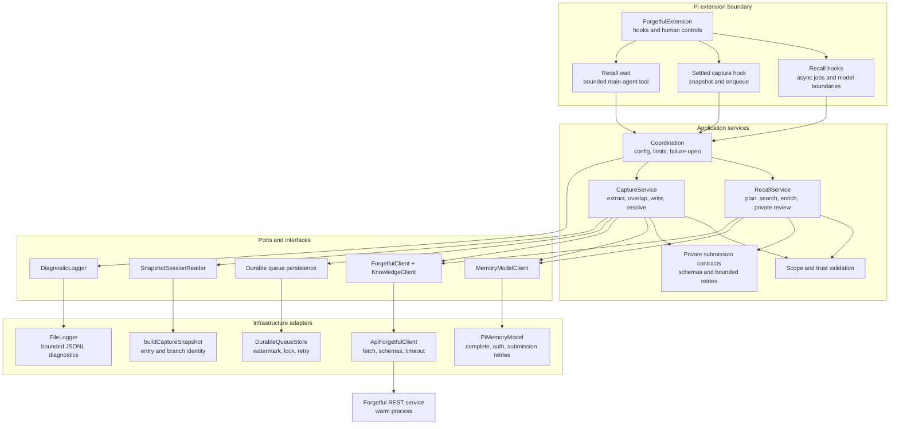

# Pi Forgetful

A seamless persistent-memory extension for the Pi coding agent.

The intended experience requires no memory commands during normal work:

- a separately configured memory model plans recall while the main agent starts work;
- every behavior-driving private model response uses a schema-validated submission tool, never
  parsed JSON text; compaction summaries remain contextual text;
- automatic recall gives the main agent only bounded context reviewed through a private,
  schema-validated submission tool; raw search results are never a fallback;
- pending and retrieval recall states are transient; each useful reviewed result is saved once
  as a hidden Pi conversation message, available to later requests and normal compaction;
- the initial pending marker persists normally; the useful result itself continues the turn,
  without a separate saved wake; recalled facts are untrusted and excluded from capture evidence;
- `forgetful_recall_wait` is the sole main-agent tool and uses normal Pi tool-result persistence;
- deliberate main-agent memory access uses independently configured CLI/MCP access and its skills;
  setup can hand configuration guidance to the main agent, but the extension itself does not install
  or configure those clients or require their connection to match background REST;
- startup does local setup only; project discovery and recovery run in the background, with one
  transient activity widget; early settled turns are queued durably until discovery completes;
- settled capture pins session/branch history, reusing a successful historical summary plus
  recent messages; initial preparation checkpoints each summary chunk with its exact source
  boundary before yielding, separately from extraction's call allowance; partial summaries stay
  job-local, and provider replay fields are omitted only from the model-facing view;
- eight-claim capture passes automatically continue eligible work while Pi remains open; failed
  branches are deferred for the drain cycle and busy worker locks get cancellable delayed checks;
  source evidence remains durable until success or three failed/permission-paused attempts;
  preparation-only progress and ordinary lifecycle cancellation do not consume that allowance;
- shutdown cancels capture models/reads and allows accepted writes a 500 ms receipt grace period;
  uncertain mutations stay pending without replay; disk checkpoints and lock release are awaited;
- snapshots remain separate from the 50 MiB queue index; watermarks prevent replay independently
  of context summarisation, and completed jobs retain only small outcome records;
- capture can inspect sources read-only; recall can explore only stored Forgetful knowledge;
- private tasks use a configurable 100k-token context limit, capped by the selected model window,
  with Pi compaction settings, reply generation capped to the model/reserve/remaining budget,
  validated submissions and bounded correction attempts;
- successful summary cursors move forward per session/branch; inactive summary caches expire,
  and cache damage falls back to pinned history without masking original-source failures;
- capture can create and link memories, entities, relationships, documents, and code artifacts;
  file uploads are excluded;
- safe execution failures receive immediate correction through a new private task with a real
  failure-report tool result; three execution attempts per cycle survive yields/restarts, separate
  from private submission attempts and the queue failure allowance; completed/uncertain writes
  are never replayed, and connection corrections retain their own review context;
- configured scope is authoritative and independent of each capture destination; global scope
  allows cross-project capture links, while project scope keeps links within the destination;
  queued capture uses its pinned scope, and both link endpoints must remain active;
- human setup, project, logging, verbosity, scope, capture, model, and enablement controls remain
  available on demand; these settings do not control independent CLI/MCP clients.

Recall defaults to global search. Capture defaults to the current project, but may select another
existing project when the evidence supports it. Clear complete changes supersede old memories
while preserving history. Additive refinements can merge into a complete replacement, preserving
existing active links and attachment references before retiring predecessors; obsolete links stay
on the historical originals. Check inherited connections before creating a merge replacement, and
all retirement targets before the first DELETE. Model-call budget exhaustion defers work without a
failed attempt. Standalone retirement needs no new memory; reasons use Forgetful obsolescence
metadata. The model chooses these actions; the extension executes reliably without extra semantic
rules. Recall remains read-only. Uncertain conflicts return to their originating conversation on
its next user turn, without waking an idle agent. A conflict becomes locally `handed_off` only
after its notice is saved in that conversation; this never means that the server conflict was
resolved. The main agent agrees a resolution with the user and applies it through independent
CLI/MCP access. Unavailable access or failed writes remain unresolved, with no fallback extension
writer. Existing partial and uncertain write records remain untouched; handoff must not discard or
replay their saved progress.

Post-exit capture completion remains beyond the MVP; the durable queue remains in scope.
See [the approved design](docs/design.md).

## High-level architecture

Before changing code or reasoning about this repository's architecture, read the
[Mycelium class diagram](docs/assets/mycelium_class_diagram.md).

After source-code changes, use the `mycelium-mermaid` skill to regenerate that map before declaring
work complete or committing. Preserve full detail; explicitly exclude `test` and
`scripts/forgetful-test-server.py` with `--test-path`. Verify expected source areas and repeat-export
determinism. Include the refreshed map in the same commit when it changes. Do not hand-edit generated
content. Documentation-only changes do not require regeneration. If generation fails, report the
blocker rather than treating the existing map as current.

Pi lifecycle code remains separate from memory policy and transport details. The MVP uses a warm
HTTP REST service behind transport-neutral memory and knowledge ports. Background recall/capture
does not use MCP. The main agent's independent CLI/MCP integration is outside this extension.
A future background CLI adapter must preserve the same scope, validation, timeout, and failure-open
boundaries.

An editable Excalidraw version is available at
[docs/code-architecture.excalidraw](docs/code-architecture.excalidraw).

## Forgetful integration and tool-error handling

Preserve what Forgetful actually said, not an extension-written interpretation: HTTP status,
JSON or non-JSON response body, validation field details, plain `Not Found` responses, and service
or network diagnostics. This includes 5xx errors. Known-secret redaction and transport limits still
apply. Failed private tool calls return error results to their model immediately; source errors
retain their structured details. Optional recall failures remain diagnostics, not recalled facts.

Error visibility and permission to retry are separate decisions. For capture execution, classify
failures using HTTP status, error type and dispatch receipts, never guesses from error wording:

- Confirmed HTTP 400/422 rejections allow immediate, bounded model correction of the rejected
  instruction. A 404 lookup before mutation, or an explicit local target-selection error, can
  likewise let the model correct its selection. Never silently choose a different destination.
- HTTP 5xx, 429, transport timeouts and connection failures retain their original diagnostics for
  normal queue retry where safe. Do not spend extra correction-model calls on service outages.
- A failed dispatched write may already have succeeded. Unless its rejection is definite under
  the existing receipt rules, keep it uncertain and blocked; never blindly replay it. A mutation
  404 is not equivalent to a missing-record lookup. Completed writes are never replayed either.
- Permission loss and lifecycle cancellation pause work through their existing handling; they
  are not errors for the model to correct. Lifecycle cancellation consumes no correction attempt.

Correction uses a new private task, not a reconstructed original conversation. The model must call
`report_capture_execution_failure` to receive the saved instruction, original error and receipts
as a real paired error result before submitting a correction. That tool only reads saved failure
information. Candidate/resource correction and connection review retain their separate contexts.
Keep synchronous submission validators free of network writes.

An execution correction cycle permits three total executions: initial plus two corrections.
Its remaining allowance and reserved attempt survive budget yields and restarts. This is separate
from the three private submission attempts, per-pass model-task budget and three failed queue
attempts. Only a later eligible queue retry may start another bounded execution cycle. Read-tool
exploration retains its deadline/context bounds, not a new three-read-error limit.

## Repository hygiene

Keep agent handoffs and disposable review reports outside the repository. Put durable guidance in
existing documentation, not session-summary documents. Remove temporary review artifacts when the
review ends unless the user asks to keep them.

## Status

MVP implemented for Pi 1. Run `npm run check` for deterministic
regression and real Pi SDK integration tests. Set `FORGETFUL_TEST_SOURCE` to a Forgetful checkout
for isolated real REST tests. Real-model judgment and latency checks are separately opt-in.
See [setup and controls](README.md).
