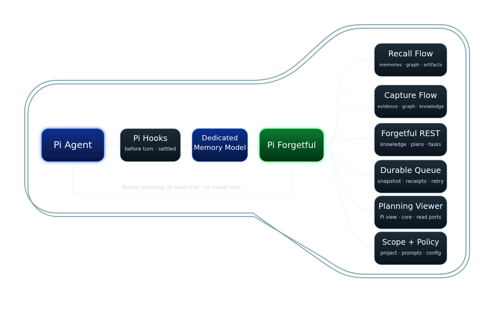

# Seamless Forgetful memory for Pi

## Decision

Build a Pi extension that makes Forgetful recall and capture automatic by default while
remaining silent, configurable, bounded, and failure-open.

The first vertical slice includes both recall and automatic capture. The extension uses the
existing Forgetful REST API; changes to the Forgetful service are not assumed.

## Knowledge access boundary

The extension owns automatic recall and capture. Its only main-agent tool is
`forgetful_recall_wait`; private `read_forgetful` and the internal knowledge readers and writers
remain available to automatic work.

- Automatic recall uses memories and entities as entry points. It follows a bounded number of
  relevant relationships and document/code references within the existing deadline and context
  budget. Optional record failures preserve candidates for review while time remains. No unreviewed
  candidate is injected if the overall deadline expires.
- Automatic capture can store documents and reusable code and link memories to entities and
  relationships. It excludes file uploads. Resource IDs and completed links are checkpointed so
  an interrupted capture can continue. Query-before-create still cannot guarantee atomic
  deduplication across simultaneous sessions or server-side races.
- Human setup, status, settings, scope, capture and model controls remain, along with
  `/forgetful project init`. Connection setup stays separate from repository project mapping.
- Deliberate main-agent knowledge access uses independently configured Forgetful MCP/CLI clients
  and their skills. Explicit recall, knowledge read/write, agent project-init and resolver tools,
  the six bundled manual skills, and `/forgetful encode` are removed from this extension.
- `/forgetful setup` offers agent-led help before collecting REST connection details. It first asks
  whether a new instance is needed; otherwise it offers help configuring existing access for Pi.
  Either help path offers CLI or native Pi MCP with upstream skills, then sends the main agent a
  setup prompt instead of continuing the form. The prompt asks it to reuse working installations,
  install a missing CLI, install skills, and configure MCP when selected. All installed Forgetful
  skills are user-invoked only: set `disable-model-invocation: true` in their local frontmatter,
  preserving other content and customisations. They remain available through `/skill:<name>` without
  being advertised for automatic model selection. The prompt also asks the agent to validate and
  merge background REST settings directly, preserving unrelated configuration and
  keeping credentials out of chat and JSON. Pi's normal reload activates those settings and skills;
  changed environment variables may require a restart. No second setup run is needed.
- Declining both help offers keeps the existing validated REST form. Cancelling any wizard prompt
  leaves settings unchanged and sends no agent request. The extension remains a guide, not an
  installer: it does not acquire dependencies, configure independent clients, or validate that
  their connection matches background REST. Background work still needs a running HTTP service.
  Extension enablement, scope and capture settings do not control independent clients.

The shared `KnowledgeClient` capability extends the transport-neutral client. Its HTTP adapter
uses the existing entity, document, code-artifact and file routes, preserving authentication,
timeouts and schema validation. Memory links include `document_ids`, `code_artifact_ids` and
`file_ids`. Internal stored-file reads retain a separate bounded response allowance for binary
payloads; a configured response limit still applies. Keeping these internal capabilities does not
expose new main-agent tools.

## Architecture



The extension boundary owns Pi lifecycle hooks, commands, the bounded recall-wait tool, and
failure-open coordination. Recall uses a separately configured Pi model to plan bounded searches
asynchronously,
then reports lifecycle state and reviewed context at model-call boundaries. Capture snapshots a
settled session branch into a durable queue, then uses the same transport-neutral Forgetful client
to create, merge, supersede, retire, or escalate candidate memories. The HTTP adapter is the MVP; a
future CLI adapter can be added without changing the application services or policy contracts.

The presentation source for this diagram is [architecture.svg](assets/architecture.svg). The
expanded layer-by-layer version remains available in
[code-architecture.excalidraw](code-architecture.excalidraw).

## Review decisions

The following choices describe the approved extension boundary:

- Capture starts in `auto` mode in the first slice, with `off` and `observe` controls retained.
- Only `forgetful_recall_wait` is exposed as a main-agent tool. Its normal Pi tool results may
  persist in session history; deliberate knowledge access belongs to independent clients.
- Recall defaults to global scope. Users can opt into strict project recall explicitly; scope
  enforcement uses the existing Forgetful search contract.
- Capture associates each new memory with the current project by default. The agent may select
  another existing project when the completed work concerns it, without a separate user prompt.
  This per-candidate destination does not change the repository's persisted recall scope.
- Capture checks both duplication and contradiction against existing memories. A contradiction
  is a distinct outcome with evidence, not an ordinary duplicate to discard. Clear, evidenced
  changes automatically supersede the old memory while preserving its history. Uncertain
  conflicts are escalated to the main model through the bounded handoff described below. Additive
  refinements merge into a complete replacement with inherited connections; standalone retirement
  handles obsolete knowledge without requiring a new fact. Recall remains read-only.
- Query-before-create is the only duplicate boundary. Race and retry risk are accepted for this
  slice; no stronger Forgetful write contract is proposed without explicit approval.
- The planner uses a separately configurable authenticated Pi model, distinct from the active
  main-agent model.
- Automatic recall does not hold the main model behind planning or review. The first model boundary
  receives an explicit pending state and stable instructions to continue independent work. One
  latest-state renderer replaces stale recall rows at each model boundary. Retrieval progress is
  passive when the main model is already working; it never requests a progress-only turn. The
  renderer supplies one bounded context, no-context, or failure terminal state.
- `forgetful_recall_wait` is the finite, lifecycle-compatible wait mechanism. The main model may
  use it once when memory is required, then defers memory-dependent answers or actions until the
  terminal state. A timeout does not cancel the planner. Real Pi abort, memory-off, session, and
  branch invalidation cancel jobs; normal stop does not.
- Recall jobs carry session, branch, generation, request, and job IDs. Queued follow-up input
  starts recall immediately but activates and delivers it only for its matching user-entry
  boundary, including identical prompts in FIFO order. Stale jobs cannot publish progress,
  terminal context, or follow-up turns.
- Recall lifecycle messages use Pi custom messages with `display: false`. Pi persists those entries
  and may include them in later model calls, so hidden display is not privacy. Lifecycle content is
  bounded, untrusted, and must contain no secrets; capture excludes it as evidence.
- Repository/project mapping is resolved from the Git remote and the project's `repo_name`.
  `/forgetful project init` explicitly creates a project or links an unassigned existing project
  after user review. It reuses an existing exact match and rejects ambiguous mappings. Connection
  setup remains separate. If a destination cannot be resolved, the affected capture or project
  recall skips with setup guidance. Global recall can still run without a project mapping.
- The effective recall scope defaults to global. An explicit choice is persisted per repository
  in `.pi/forgetful/settings.json` and is reloaded whenever the project is revisited.
- The persisted recall scope is authoritative. The recall planner cannot change it for an
  individual operation; the user changes it through the scope command or project settings.
- HTTP is the only Forgetful transport in the MVP. Application services depend on a
  transport-neutral `ForgetfulClient` port so a CLI adapter can be added later without changing
  the core services or policies.
- Any proposal to change Forgetful itself must be escalated to the user with justification.
- Completion of capture after Pi exits is deferred beyond MVP. Keep the durable queue, but do
  not add an external worker, daemon, or shutdown-completion requirement for this slice.

## User experience

During normal work, the user enters ordinary Pi prompts. They do not invoke memory commands.

The extension:

1. starts a recall job for each new user prompt while the main model begins independent work;
2. gives the first model boundary pending state and stable wait/defer instructions;
3. renders the latest retrieval or terminal state at later model-call boundaries without a
   progress-only turn;
4. lets the main model use one finite `forgetful_recall_wait` when memory is required;
5. keeps queued follow-up recall isolated to its matching request and cancels stale jobs;
6. leaves memory IDs, entity names, and topic leads for deeper exploration;
7. leaves deliberate knowledge access to independently configured MCP/CLI clients and skills;
8. evaluates completed work for durable knowledge after `agent_settled`;
9. assigns each candidate to its relevant project, checks for duplicates and contradictions, and
   quietly creates novel, high-confidence memories through the existing query-before-create path;
10. automatically supersedes clearly outdated facts and retains uncertain conflicts with memory
   IDs and supporting evidence for escalation.

Memory failure must never block the user's task. The context hook renders pending, retrieval,
no-context, and failure states transiently and removes stale recall control messages. Each useful
reviewed result is saved once as a hidden Pi conversation message for its matching request and
branch. This applies to automatic and queued recall, whether the main agent waits or completion
arrives later. Saved results survive restart and participate in normal conversation compaction;
native-compaction adapters can read them from saved history. Older results remain historical data
and do not override the current request. The result itself is delivered as a steer continuation,
so it reaches saved history before the next model request. No separate wake message is saved.
Policy instructions stay request-local, outside the saved facts. The initial pending marker
persists normally too. Hidden messages are not private storage; result text must be bounded and
redacted. Capture excludes recall messages as evidence. `forgetful_recall_wait` results follow
normal Pi tool-result persistence.

## Pi feasibility

The implementation is tested against Pi 1.3.0 and uses these extension seams:

- `before_agent_start` can modify the system prompt for the current turn;
- `input` starts queued recall without blocking Pi's queue, and `context` activates only the
  matching queued job. Lifecycle messages may persist as hidden Pi custom entries;
- `agent_settled` runs after retries, compaction, and queued continuation have stopped;
- `ctx.modelRegistry` exposes configured models and resolved authentication;
- `ctx.scopedModels` supports a model picker consistent with the user's Pi configuration;
  the extension must persist the selected memory-model ID itself;
- Pi's bundled `complete()` API can make a focused model call without a subagent process;
- an extension can register a bounded recall-wait tool;
- `pi.exec` and Node's built-in `fetch` support local process and HTTP integration.

A separate agent subprocess is unnecessary. A focused direct model call is faster and has a
smaller failure surface.

## Recall flow

1. On `before_agent_start`, create a session/branch/generation-scoped job and start the planner
   without awaiting it. Return stable protocol instructions and a pending lifecycle message.
2. Require one private `submit_recall_plan` tool call and validate its bounded arguments:
   - `search`: boolean;
   - one or two topic queries;
   - query intent;
   - zero or more entity names.
   Invalid, unknown, duplicate, or semantically rejected calls receive validation feedback;
   text-only replies receive a correction, never JSON parsing. Allow up to three submission
   attempts within the same recall deadline. No validated plan means no searches.
3. Resolve the effective scope from the persisted project setting. The planner cannot replace
   this user-controlled scope for an individual operation.
4. Search a warm Forgetful HTTP service. When the plan selects retrieval, the next model boundary
   renders retrieval-underway state if the result is not ready; this passive update does not steer
   or trigger a model turn. Initial searches overlap up to the user `recall_concurrency` limit
   (default 2, integer 1–8). Preserve query order when merging successful results and expose
   every failed search's actual error to the reviewer.
5. Ask the same memory model to review selected memory and rich results against the question and
   session context. Do not shorten the selected records, session entries, or policy by character
   count before sending them to the model. It submits a summary, selected source IDs and a brief
   selection/rejection reason through a private `submit_recall_review` tool. Validate IDs against
   sources actually shown to the reviewer. Invalid, unknown, duplicate, or semantically rejected
   calls get an error tool result; text-only replies get a correction message. Both may retry,
   up to three total attempts under the same deadline. The private correction history retains
   redacted rejected arguments but never enters main-agent context or Pi session history.
   Inject only the summary and validated references, never raw results or appended
   attachments. Nothing relevant means no injection. Failed, timed-out, or exhausted review
   injects nothing, without a raw fallback. Read calls requested together by the reviewer use
   the same concurrency limit and retain tool-call order in history. The task supplies a fresh
   `availableSources` snapshot after the batch so earlier per-read snapshots cannot supersede
   delivered evidence. A freed slot starts the next waiting read; caller cancellation and the
   shared deadline stop waiting reads from starting and abort in-flight HTTP requests. Capture
   reads remain sequential. The limit is per recall, not a global service connection limit or a
   total-query cap; supporting knowledge expansion keeps its existing bounds.
6. Deliver one current terminal state: bounded reviewed context, explicit no-context, or explicit
   failure. Save each useful reviewed result once as a hidden conversation message on its matching
   session, branch, and user-entry boundary. Send the result itself as a steer continuation so Pi
   saves it before the next request; do not send a separate generic wake. Until the result is in
   history, render an arriving state without a temporary copy of the facts. Do not persist stale
   completions, duplicate results, or start another planner. Empty and failed results remain
   transient.
7. Let the main agent call `forgetful_recall_wait` once when it needs the terminal state. Its
   returned content is ordinary Pi tool-result content and may be stored in session history.
   Further deliberate searches require independent MCP/CLI access.

Retrieved memory is untrusted historical context, never executable instruction. Pending and
progress text is trusted lifecycle protocol; recalled terminal text is untrusted data. The review
summary remains bounded by the existing review contract (3,000 characters). This is a validated
submission-field limit, not a limit on the evidence or reasoning available to the reviewer. Only the
current pending or retrieval state is rendered at a model-call boundary. Useful reviewed results
remain in branch history, while persisted markers and tool results follow the rules above.
Review summaries are also untrusted. One bounded planning path and one bounded review path share
an overall recall budget with search and optional enrichment. Each stops after its first valid
private submission and never parses text-only output as JSON. All behavior-driving memory model
requests require a schema-validated submission tool; only context summaries remain plain text.
Independent clients retain their own result handling; this extension does not review their output.
Lifecycle delivery never recursively starts recall or capture.

## Recall/link scope and capture destination

Global recall is the default. If `.pi/forgetful/settings.json` contains an explicit scope
override, load and validate it before planning the request. Resolve the canonical repository
identity to an existing numeric Forgetful project ID when project recall is selected or capture
needs a destination. Resolve the mapping from the active work context; never create a project
silently. Missing or ambiguous mappings require setup guidance rather than a guessed ID.

For global recall, omit project filtering and send `strict_project_filter: false`. In project
recall, every search request must send the resolved numeric project ID with
`strict_project_filter: true`. Forgetful owns search filtering and the scope of returned
search results; the extension does not revalidate their project IDs. Automatic supersession
separately checks a selected memory before mutation, as described in the adapter contract.

Project-scoped recall is opt-in through the scope command or the persistent per-project setting:

```text
/forgetful scope
/forgetful scope project
/forgetful scope global
```

`/forgetful scope` reports the effective scope and its source. The scope commands update
`.pi/forgetful/settings.json` so the choice is retained when the project is revisited. If the
settings file is absent, global scope is used. If the scope setting is malformed, ignore it,
surface configuration guidance, and use the global default; never interpret malformed data as
project scope. Only the user-controlled scope command or a direct settings edit changes
this file.

If project setup is missing or invalid, project-scoped recall skips and provides setup guidance.
It must never silently fall back to global search. Debug output shows the effective recall scope
and resolved project ID.

Capture destination is independent of recall scope. Each candidate defaults to the current
project, even when recall searched globally. The agent can override that destination to another
existing project when supported by the completed work. For example, a fix to Forgetful made while
working on this extension belongs to the Forgetful project. The capture model may use the main
agent's project context as evidence and selects an existing target project per candidate.
A separate override rationale is not required.

The configured scope also governs capture link review and link mutations. Global scope permits
active cross-project endpoints, including shared memories. Project scope retains destination-only
link changes and excludes shared/foreign endpoints from automatic full-record selection. The saved
memory must remain active and in its selected destination in either scope. Capture uses the scope
pinned in the queued snapshot; later settings changes do not reinterpret queued work.

Resolve and validate the destination before overlap checks. Query for duplicates and
contradictions using that project's ID and `strict_project_filter: true`, then use the same
`project_ids` on create. A validated per-candidate project override needs no additional user
approval and cannot alter persisted recall settings, the service endpoint, or credentials.
If the intended destination cannot be resolved, skip that candidate with setup guidance instead
of silently writing to the current project or without a project. Global recall does not imply
project-free capture; personal facts that do not belong to a project need a separate policy.

These boundaries govern this extension's automatic work only. `/forgetful off` and recall scope
settings do not disable or restrict independent MCP/CLI access, including external resolution
writes. Those clients have their own configuration, permissions and workflows.

Scope enforcement uses the existing Forgetful service contract. The extension adds only local
persistence for the user's per-project scope preference; it does not add a new cross-project API
or memory persistence mechanism.

## Forgetful instance configuration

The MVP connects to a user-configured, already-running Forgetful HTTP service. Instance
connection settings are user-level and live under `~/.pi/agent/forgetful/settings.json` (or the
equivalent user settings mechanism), separate from the project-local scope setting:

- `base_url`, defaulting to `http://localhost:8020/api/v1`;
- the configured authentication reference, resolved from user-owned environment or credential
  settings rather than committed project files;
- the bounded request timeout.

The project-local `.pi/forgetful/settings.json` stores the repository's scope preference only; it
must not select the Forgetful endpoint or contain credentials. The service must be reachable
before recall or capture runs. The extension does not start or manage the Forgetful process in the
MVP.

## Forgetful adapter contract

Application services depend on the transport-neutral `ForgetfulClient` port. The MVP
`ApiForgetfulClient` is the only adapter and is the only code that knows the Forgetful REST
request and response shapes:

- search: `POST /memories/search` with `query`, `query_context`, optional numeric `project_ids`
  for project recall or the capture destination, and the explicit `strict_project_filter` value;
  Forgetful owns search filtering and returned-memory scope validation;
- project lookup: `GET /projects` with `repo_name` when available, resolving an existing numeric
  project ID from the candidate's work context; missing or ambiguous matches do not create one;
- explicit project initialisation: `POST /projects` with name, description, `repo_name`, and
  `project_type: development`, or `PUT /projects/{id}` with only `repo_name` to link an unassigned
  project. Recheck after confirmation and verify the resulting mapping before using it. These
  checks reduce races but are not atomic; the server does not enforce unique repository links;
- create: `POST /memories` with the required `title`, `content`, `context`, `keywords`, and
  `tags` fields, plus the resolved capture destination in `project_ids`;
- read for automatic supersession: `GET /memories/{id}` for the selected memory, checking its
  current content, project associations and obsolescence state;
- supersede: first create the replacement, then `DELETE /memories/{id}` with `reason` and
  `superseded_by` set to the confirmed replacement ID. This route marks the old memory obsolete
  and preserves its history; the operation is not a hard delete. Standalone retirement uses the
  same route without `superseded_by`. Both store the reason in the old record's `obsolete_reason`;
- validate HTTP status codes and response schemas before returning data to recall or capture;
- use configured authentication, never log credentials, and require TLS for non-local endpoints;
- apply bounded per-request timeouts and abort signals to every network call.

The current create route has no idempotency key. Query-before-create remains the duplicate
boundary in this slice. Create-then-obsolete is also not an atomic transaction, and the read
before mutation is not a compare-and-swap guarantee. The adapter must not claim otherwise.
Any proposed Forgetful API or persistence change is escalated rather than hidden in the extension.

Errors preserve the actual HTTP status and response body, including JSON and non-JSON bodies,
validation field details, plain `Not Found` responses, all 5xx statuses and service diagnostics.
Known-secret redaction and transport limits still apply. Private tools return those details to
the memory model instead of substituting an extension interpretation; automatic recall retains
its failure-open boundary. Network diagnostics preserve useful underlying causes with bounded,
cycle-safe traversal and known-secret redaction. Optional enrichment failures reach private review
separately from source evidence, without discarding successful sibling reads. They never become
raw recalled context or capture evidence. Recall-wait exceptions retain actionable cancellation
and stale-session reasons.

## Capture lifecycle and durability

`agent_settled` is a trigger, not a capture payload. Pi awaits extension handlers for this event,
and the event does not carry the completed conversation delta. The handler must therefore do a
small enqueue-only operation and return; it must not perform model calls or Forgetful writes
before returning.

The extension-owned capture queue must be durable before automatic mode is enabled:

1. Pin the complete active conversation at settlement, using stable session/branch entry IDs
   and the final assistant status. Include pre-compaction history, roles, calls and actual outcomes;
   never reread a mutable session later and assume it is the same run.
2. Persist sanitized history in immutable private snapshot files, referenced by the 50 MiB queue
   index with a verified digest. Reuse a successful summary only for the same session/branch and
   matching source boundary; retain recent messages and original unprocessed evidence. Persist
   private-model compaction so stages and retries can reuse its summary plus unchanged tail.
   Before preparing still-unextracted queued work, atomically refresh its model view from a newer
   completed branch summary whose boundary lies within the pinned originals. Preserve all pending
   evidence and the exact suffix; never regress local summary progress or reset outcomes/receipts.
   Legacy entries-only or partial histories stay unchanged; reuse cannot establish native coverage.
   This also applies to tasks enqueued before the successful summary existed. No model/policy
   version compatibility keys or queue migration are required.
   Initial capture preparation performs at most one summary request per slice. Checkpoint each
   accepted, reducing summary and its exact advancing source boundary before the next slice.
   Partial progress belongs to that job, not the reusable branch cache. A progress-only yield
   spends neither a failure attempt nor the extraction-call allowance; real failures still count.
   Keep original native source records separately from that model view, preserving images, tool
   arguments and failures until success or exhausted attempts. Conflicts verify origin against
   these originals, not the compacted view. Retained source records never go in the queue index.
   The index retains project context, recall scope, capture mode, run identity and prompt/model
   versions. Record each candidate's resolved destination before writing, so retries do not
   reroute it from a changed working directory.
3. Advance the capture watermark with the durable enqueue. A stable session/branch plus final
   entry identity (and snapshot hash where needed) prevents the same settled turn being queued
   twice after retries, compaction, or restart.
4. Run one locked worker per session/branch, with serialized queue-file mutations. On Pi restart,
   recover a saved branch only when its latest handled entry is on the active journal path; choose
   the furthest matching same-session boundary. Divergent paths get a new branch, including
   repeated visits to the same fork point when its old branch no longer matches. Lookup failure
   logs the actual error and falls back without blocking recall. Recover pending records after
   restart, retaining per-candidate receipts and evidence for retries. Each pass claims at most
   eight jobs. Schedule follow-on passes while eligible work can advance, including an underfilled
   preparation-only pass. Carry failed/permission-paused branch exclusions across the drain cycle
   and its already-waiting settled callbacks; do not immediately spend their remaining attempts.
   Continue other healthy branches. Worker-lock contention uses delayed, cancellable rechecks
   without taking ownership from a live worker. Keep these passes on the existing serial lifecycle
   tail; no new daemon or queue is introduced.
5. Complete a job only after all candidate outcomes are recorded. Advance the successful capture
   cursor without moving backwards; it is distinct from enqueue receipts and summary progress.
   A newer completion does not mark older pending jobs finished. Release bulky search/review
   payloads and retain small UI outcomes; troubleshooting details belong in opt-in logs.
6. Failed and permission-driven paused attempts count. Ordinary lifecycle cancellation releases
   the claim without spending a failure attempt or the interrupted model-call allowance. The third
   failed or permission-paused attempt discards the job, sidecars and associated conflicts,
   returning a final outcome for UI reporting. Exhausted model-call budgets fail rather than pause.
   Abandon unfinished knowledge rather than retaining a manual cleanup backlog. Separate
   deduplication markers prevent replay. Successful jobs may retain evidence for pending conflicts.
7. Publish reusable summaries with forward-only source-ID cursors on compatible paths within each
   session and branch, separately from enqueue deduplication and completed capture progress.
   Keep at most four completed caches, evicting the oldest publication when necessary. Select
   the furthest boundary present on the receiving job's pinned path, never order separate paths
   by timestamps. Preserve full and inherited source-ID ordering in summary sidecars, with only
   bounded cursor metadata in the index, so older retries cannot replace newer compatible history.
   Ordering alone does not establish usability across forks: reject older/equal publication only
   when a cache boundary is on the completion's path or the completion is a proven prefix retry.
   Supersede an older cache only when the completion also extends its producing path; otherwise
   retain shared-prefix history that another fork may still need.
   Existing single-cache records remain readable; queued completions can add a compatible cache
   without removing their evidence or resetting receipts. Expire inactive caches, protecting
   active jobs and pending conflicts. Missing or corrupt reusable summaries fall back to pinned
   session history with the actual error in existing logs; original source damage remains an error.

The worker is not awaited by `agent_settled`, so automatic capture cannot delay the user's next
turn. An in-memory queue or a timestamp-only watermark is not sufficient. The queue prevents
extension-level replay, but query-before-create remains the only Forgetful duplicate boundary;
it cannot prevent two independent clients from racing to create the same memory.

The MVP worker runs inside the live Pi process. Durable pending records can be recovered on a
later normal start, but capture completion after Pi exits is not an MVP guarantee. External
workers remain deferred. Shutdown and navigation abort capture model/read requests immediately.
Already-dispatched writes get a 500 ms response grace period before transport cancellation. Returned
receipts are checkpointed; unacknowledged mutations stay pending with an uncertain-outcome marker
that blocks automatic replay. Local queue writes, worker lock release and receipt checkpoints are
awaited before teardown completes. This does not promise post-exit completion.

Session loading performs only local setup before returning. Remote project discovery and recovery
run asynchronously. Prompts do not wait for discovery, and automatic recall skips an unready turn.
Settled turns are queued locally with a pending-discovery marker. A successful discovery updates
only matching repository/service queue records before workers claim them. Discovery failure leaves
those records unclaimed, without consuming attempts. No second queue or post-exit worker is added.

Queue files live under the user's Pi agent directory, in `forgetful/queues/`. The directory key
separates repository and service/account identity. Repository-controlled settings cannot redirect
the queue or select service credentials.

## Capture flow

Capture is scheduled after Pi emits `agent_settled`. This event means Pi has finished the
agent run and will not automatically continue through retries, compaction retries, or queued
follow-ups. It does not itself mean the work succeeded, so the extension must inspect the final
assistant message and skip capture when its stop reason is error or aborted. The fixed snapshot
is then processed by the durable worker described above.

1. Read the whole pinned conversation. The watermark marks processed work; it does not remove
   context. Capture exclusions remain attached to original entry IDs across branches. Evidence
   eligibility is separate from visibility; failed tools establish failures, not successful changes.
2. Ask the configured Pi memory model for atomic, evidenced candidates, without a fixed candidate
   count cap. Maintenance-only items carry a search description and evidence IDs instead of a
   proposed stored memory. Resolve each to an existing target project. An unknown explicit model
   selection gets bounded correction with the actual project list; never silently redirect it.
   Missing project setup still requires human guidance. Do not create projects automatically.
   It may inspect trusted repository text and source URLs through a read-only tool before
   submitting candidates. Actual
   observations carry durable evidence IDs and provenance; failed inspections carry the same
   structured diagnostic and evidence reference in an error tool result. Permission revocation
   pauses capture without saving inspection evidence. Source editing, shell execution and uploads
   are unavailable. It may also use `read_capture_evidence` to selectively read this task's
   pinned originals by entry ID, without
   changing evidence identity or eligibility. Reads are optional, not a required read-before-cite
   check or a guarantee that every fact omitted from a summary will be discovered. Text pages
   default to 4,000 characters (maximum 16,000), with explicit continuation offsets and original
   native images on the first page. The existing task deadline and context budget still apply.
   Revoked capture/read permissions pause the task through the model boundary, not as ordinary
   tool feedback that permits another provider turn or an empty successful capture.
   Accept exactly one private `submit_capture_candidates` submission; do not parse text output
   as fallback JSON.
3. Validate the private submission envelope and one to eight eligible evidence IDs per candidate.
   Assistant text, memory operations and excluded entries remain ineligible. Evidence categories
   do not impose source-role checks. Missing or duplicate candidate keys receive stable local keys.
   JSON strings are never decoded into instructions. Stored memory/resource field requirements,
   types and lengths belong to Forgetful, not a second extension validator. Forward those fields
   unchanged, including invalid values, and return actual server errors for correction. Redact
   model context and diagnostics; do not silently rewrite the model's stored payload.
4. Query Forgetful for semantic overlap in each accepted candidate's destination project.
5. Give candidates, their evidence and full destination-scoped records to the memory model.
   Accept a private `submit_capture_decision` or batched `submit_capture_decisions` call with
   `create`, `skip`, `merge`, `supersede`, `retire` or `escalate`. Resource reuse requires explicit
   existing IDs; entity-memory links require selected keys. `skip` writes nothing unless
   `enrich: true` explicitly requests resource additions and connection review for the selected
   memory.
6. Validate action names and one decision per candidate, including known, unique candidate IDs.
   Existing-memory targets need not come from the overlap query. The model judges contradiction,
   replacement completeness and resource suitability; code does not require explanatory claims,
   restrict sibling reuse to earlier same-project candidates, or revalidate selected resource keys
   against the neighborhood. Each private submission retains three attempts under its deadline.
7. Execute `create`, `merge`, `supersede` or `retire` through the existing Forgetful API using the
   write path below. Record `skip` and `escalate` distinctly; an unresolved conflict is
   neither an ordinary duplicate nor permission to create a competing fact.
8. If a decision is malformed, reject the write and record the reason. Retain a valid uncertain
   conflict for escalation. An arbitrary confidence score alone does not authorize supersession.

A contradiction means incompatible claims about the same subject and applicable context.
Different projects using different databases is not a contradiction. A current user decision
or evidenced change can challenge an old memory; an assistant suggestion or repetition of
recalled text alone is not independent evidence. Similarity alone does not establish conflict.

Automatic resolution is agreed for clear changes. For example, an explicit decision that the
project has switched to SQLite can supersede the old PostgreSQL decision; a suggestion to
consider SQLite cannot. Retain the superseded memory as history, linked to its replacement.

The capture service applies supersession in this order:

1. Check capture enablement, auto mode and live write permission. Content or destination changes
   do not authorize the executor to replace the model's instruction with escalation.
2. Record the create attempt, create the model-supplied replacement and durably record its ID.
   Execute explicit connection/reference selections; omitted preservation leaves attachments alone.
   Do not require replacement attachment selections to come from supplied records or satisfy local
   resource caps, reasons or project checks. The API owns stored-resource validation.
3. Mark each selected old memory obsolete with the requested replacement ID, recording each result.
   If an operation fails safely, checkpoint its actual instruction, error and receipts, then start
   a funded correction task before ending the drain with a retry warning. The model must call the
   read-only `report_capture_execution_failure` tool, receiving the saved failure as a paired
   error result, before `submit_capture_correction` can revise rejected fields. This is a new
   private task, not continuation of the original submitting conversation. Connection failures
   use their existing connection-review submission with the same reporting requirement.
   HTTP 400/422 dispatched rejections allow correction; uncertain writes remain blocked across
   restarts. A pre-dispatch missing-record read is distinct from a dispatched mutation failure.
   Outages (5xx, rate limits, transport timeouts or refused connections) use normal queue retry,
   retaining their original diagnostic without asking the model to revise valid instructions.
   Classification uses status, error type and dispatch receipts, not error-message matching.

Automatic link selection limits full records to eight active, safe endpoints. Global scope allows
cross-project and shared records; project scope selects only destination-exclusive records.
Each link submission contains at most three reviews and eight decisions per review, covering every
selected endpoint. Extra explicit targets are allowed within that decision limit. Targets remain
unique, reasons nonblank and non-sensitive, and opposing add/remove commands on one edge fail.
Before link mutation, both memories must remain active, and the saved memory must include its
selected destination. In project scope, the target must also include that destination; shared
membership is allowed for explicit targets. In global scope, the target's project does not restrict
link changes. Completed/uncertain receipts and the fresh absent-link deletion check remain.
Automatic attachment reads stay bounded to four documents, four code artifacts and eight entities;
coverage is reported separately. These read limits do not cap the model's attachment selections.

If creation fails or its outcome is unknown, do not obsolete the old memory. If obsolescence
fails, the replacement may already exist alongside it; preserve that partial outcome for retry.
Supersession retires the predecessor in every project. The replacement uses the chosen capture
destination; it does not inherit project memberships the model did not select.
Other clients can still race between validation and mutation because the existing API has no
conditional write contract. This limitation remains explicit; no service change is assumed.

### Merge and standalone retirement

The model chooses the action. Forgetful validates stored data and API operations. The extension
validates submission structure and existing trust/scope boundaries, then executes reliably; it does
not add contradiction detectors, confidence thresholds, or a second content-completeness judgment.
Targets need not have appeared in the initial overlap results.

A merge reads the full selected memories and asks the capture model to compose a complete
replacement through a private validated submission. This is composition, not a second approval gate.
It uses the existing model-call allowance. When that allowance is exhausted, checkpoint and defer
remaining work as progress, without consuming a failed attempt or asking the model to reconsider its
saved action. Checkpoint the submitted content before creating a replacement so recovery does not
regenerate it after writes begin. A definitely rejected merged payload can be corrected using the
original Forgetful response; the writing task must not recompose blindly without that error.

Before creating a replacement, read and check all inherited endpoints and references. Carry forward
the union of active predecessor memory links, entity links, document references, code-artifact
references and file references, plus newly requested connections. Obsolete memory links remain on
the historical originals and are omitted from required carry-forward. Missing or out-of-scope
required endpoints block creation. These are mechanical checks, not new semantic judgments.

Reuse existing resources, deduplicate IDs, and omit self-links and links between predecessors.
Ordinary review caps and model-selected preservation do not apply to inherited connections.
Recheck active endpoints and pinned scope before mutation. A failure after creation leaves explicit
unfinished work rather than silently dropping a required connection. Only after preservation
completes may each predecessor be obsoleted with the confirmed replacement ID and model reason.
These checks do not provide an atomic transaction against concurrent clients.

Standalone retirement checks all selected targets before the first DELETE, then obsoletes them
without a create or replacement ID. It retains their content and connections as history. Invalid
selection receives the original service error for correction before any target is retired. Fresh
checks still run before each mutation. Extraction can recognise removal-only evidence even when
nothing new deserves storing. Each mutation has a durable attempt and result; completed writes are
not replayed and ambiguous writes remain pending. Existing supersession receipts keep their original
meaning. Shared-memory retirement affects every project using that record.

Both actions send the reason through Forgetful's existing obsolescence API. It is stored as
`obsolete_reason` on the predecessor, alongside `superseded_by` for merge, and included in the
service's deletion-event snapshot. No invented provenance field or content suffix is needed.

Capture instructions should prevent duplicate, fragmented and stale active knowledge: skip unchanged
facts, merge useful refinements about the same subject and scope, supersede changed claims, retire
knowledge no longer applicable when no replacement is needed, and create genuinely separate facts.
Preserve qualifications and distinctions; similarity, age or current-request irrelevance alone does
not justify retirement. These are model guidelines rather than extension-owned semantic gates.
Recall remains read-only. There is no new maintenance sweep or main-agent tool.

### Escalation to the active session

Uncertain conflicts are handed to the main model for discussion with the user. Applying the agreed
resolution requires independently configured Forgetful MCP/CLI access and its skills. There is no
extension resolver tool or fallback writer.

1. Persist a pending conflict with its originating session/branch, destination project, old
   claim, proposed replacement, memory IDs, and source evidence in the existing queue store.
2. Select up to three conflicts at `before_agent_start` and return a native message for that
   user turn. Preserve their full sanitized reasons, claims and evidence; do not character-clip
   the handoff. This keeps next-user-turn timing: no idle wake, interruption or extra model turn.
   Selecting on the current branch avoids carrying a queued notice across navigation. The durable
   conflict record owns pending delivery, not Pi's in-memory message queue.
3. Keep the conflict pending until the matching notice is saved in the originating conversation.
   Enqueueing a notice or rendering it transiently is insufficient. Only then record a local
   handoff. This records delivery, not resolution in Forgetful or a successful external write.
   Pending delivery survives restart; session and branch restrictions remain authoritative.
4. The main model discusses the evidence with the user, obtains any missing clarification and
   uses independent MCP/CLI access to apply the agreed resolution. If access is unavailable or
   a write fails, it reports the conflict as unresolved instead of claiming success.

The extension does not track external resolution success, parse conversation prose as a receipt,
or write a fallback resolution. Existing partial and uncertain writes and automatic capture
receipts retain their current recovery rules. Those conflict records remain pending and retain
source evidence even after their notice is saved; the saved notice prevents repeat delivery.
Handoff neither replays nor discards them, and does not convert an uncertain mutation into a
successful write.

Escalation messages follow normal Pi session persistence and are excluded from capture evidence.
Existing filtering also excludes results from recognized Forgetful tool names. This change does
not add universal CLI/MCP output detection: generic `bash` calls and wrapper tools can carry memory
output without being identified. Do not promise that every independent-client result is excluded
or that prose acknowledgements establish server success.

Never deliver a worker's conflict into a replacement session or unrelated branch. An unsaved notice
remains eligible for later recovery within the existing live-process boundary; no post-exit worker
is added. Extension enablement, scope and `capture off` controls do not govern independent clients.

Query-before-create is the only duplicate boundary for this slice. Race and retry risk are
accepted, so the extension must record per-candidate outcomes and must explicitly allow
partial writes when a later candidate or retry fails. No change to the Forgetful service is
assumed.

The first implementation uses automatic capture immediately, as agreed. Debug tooling must
still expose each candidate's destination, decision, and contradiction evidence or skip reason.

## Configurable prompts

Memory judgment is split into three prompt slots:

- `classification.md`: whether and how to search, including topics and entities;
- `recall.md`: how retrieved memories and deeper-search leads are presented to the main agent;
- `capture.md`: what completed knowledge deserves durable storage, its destination project, and
  how existing memories should be checked for duplication and contradiction.

Each prompt is composed from:

1. a versioned built-in core contract;
2. an optional global policy under `~/.pi/agent/forgetful/prompts/`;
3. an optional trusted project policy under `.pi/forgetful/prompts/`.

Prompt policy is configured through these settings files, not Forgetful commands. The trusted
project settings file `.pi/forgetful/settings.json` is separate from prompt policy files and
stores only project-local extension preferences such as the effective memory scope. Policy files
append to the built-in contract. They cannot replace protected schemas, safety rules, bounds, or
scope ceilings.

Proposed Forgetful commands:

```text
/forgetful scope
/forgetful scope project
/forgetful scope global
/forgetful capture off
/forgetful capture observe
/forgetful capture auto
/forgetful capture skip
```

`capture auto` is the first-slice default. `off` disables candidate extraction and writes;
`observe` extracts and reports candidates without writing; `skip` is a deterministic opt-out
for the current turn. A user-facing “do not remember” control must map to the same opt-out and
must not depend only on the capture model understanding natural language.

Automatic capture also applies deterministic secret and unnecessary-PII filters before any
model decision or network write. Raw transcripts, routine tool output, credentials, payroll
data, and unverified guesses are never automatic capture candidates. Memory context stores only
semantic applicability. Session, branch and evidence entry IDs remain internal for validation;
Forgetful's native source fields carry selected repository, file, URL and encoding provenance.
Recognised legacy context suffixes are removed on outgoing replacement writes, without a bulk
migration of existing records.

## Output verbosity

The default verbosity is `warning`, showing warnings and errors:

- hidden recall lifecycle messages are persisted as Pi custom session entries, but do not render in
  the UI;
- lifecycle text is bounded and untrusted where it contains recalled historical context;
- a `forgetful_recall_wait` tool result may appear in normal Pi session history;
- no success or empty-result popup;
- one transient activity widget above the editor, combining startup, recall, queue and capture
  phases with a spinner and elapsed time; it is never saved in conversation history.

`/forgetful verbosity debug|info|warning|error` persists a user-level setting without resetting
session memory work. Each level includes more severe messages. `info` adds brief recall counts
and scope; `debug` adds queries and intent, bounded retrieved candidates, selected/rejected source
IDs, review attempts and rejection reasons, the review reason and final injected summary, total
duration and redacted failures. Recoverable recall failures are warnings; invalid endpoint
configuration and capture enqueue failures are errors. Explicit command responses and normal tool
results remain visible at every level.

The old `debug on/off` commands map to `debug`/`warning`; legacy `debug: true` settings remain
supported unless an explicit `verbosity` is present. `/forgetful status` shows the current level
and, at debug level, bounded capture candidates, outcomes and pending escalations.

Debug details use user-only UI notifications and are not added to model context or extension log
files. Known secrets are redacted. This does not override normal Pi persistence of tool results.

## Latency

Latency is a product acceptance criterion. Measure:

- memory-model time;
- Forgetful search and rerank time;
- total asynchronous recall time and time to each lifecycle boundary;
- main-agent first-token time with the extension on and off;
- timeout rate and plan-cache hit rate.

Initial SLO candidates to validate:

- warm planner/retrieval p50 below 700 ms;
- warm planner/retrieval p95 below 1.5 seconds;
- hard fail-open recall timeout of 30 seconds by default (configurable);
- each classification/review request defaults to 5 seconds, independently configurable from the
  overall deadline.

The benchmark matrix covers every supported memory planner model, warm and cold service state,
search false, search hit, search miss, two-query plans, and local versus remote service. Capture
model calls are measured separately because they are not on the asynchronous recall path. The
implementation bounds recall to one planner path and one review path per prompt, with at most three
private submission attempts per path. The reviewer may explore only stored Forgetful records through
read-only tools in that same path. Capture extraction, overlap and connection review each consume
a task from the four-task budget for the current attempt. A failed-job retry resets that task count;
preparation yields and ordinary cancellation retain the current allowance. Execution correction
cycles separately allow three executions (initial plus two corrections), with a durable reserved
attempt and saved failure per candidate/path. Task-budget yields and restarts never replenish that
cycle. An exhausted cycle enters ordinary queue failure handling; only a later eligible queue
retry explicitly starts another bounded cycle. The three failed-queue-attempt limit is unchanged.
Read turns, compaction and at most three submission attempts share each task's three-minute
deadline.
Debug counts provider invocations separately. HTTP requests retain their 10-second default;
explicit `timeout_ms` overrides both HTTP and overall recall, as before.

### Model capacity and record validation

Private tasks prepare context using Pi compaction helpers and persisted Pi settings before the
first request and between continuations. User setting `context_limit_tokens` defaults to 100000;
the effective window is the smaller of this limit and the actual model window, counting policy,
tools, messages and the permitted reply. Resolve the reply allowance before each provider call as
the smaller of `model.maxTokens`, Pi's `reserveTokens` (default 16384), and the remaining window.
Use the same allowance for context validation and the raw provider request. Never clip returned
submissions into incomplete JSON. This does not change the main Pi session. With compaction
disabled, shrink the reply allowance if input fits; reject input that leaves no room for a reply.
Current task instructions and tool schemas are preserved. Historical
images use native blocks for capable models, including during summarization. Unsupported images
or indivisible records that cannot fit fail explicitly; evidence is never silently clipped.
Unsaved host settings are not available through Pi's extension context. Summaries are derived
context, not new source evidence. Pi/provider capacity failures remain failure-open.

Initial capture history has a separate bounded preparation phase before extraction is charged.
One slice makes at most one successful summary request under the three-minute timeout and durably
checkpoints accepted progress. Extraction and its private investigation/read continuations retain
one shared task deadline; recall deadlines are unchanged. Empty, nonreducing, nonadvancing or
indivisible oversized input is a real failure, never an endless progress yield. Recognised native
provider replay fields are excluded from model-facing historical records while readable content,
source identity, arbitrary tool payloads and original session/evidence files remain intact.

Selected evidence, policies, rich records and private correction history are not character-clipped.
The model adapter does not reject complete responses merely for exceeding an extension byte cap.
Character limits for the final recall summary remain locally enforced. Forgetful validates its
stored fields and read-request fields; actual server errors reach the private model for correction.
Read-only operation allowlisting, local pagination and configured recall scope remain local rules.
Corrections remain subject to the attempt count and request deadline, without shortening payloads.

Stored-record selection counts, trust and scope checks, secret redaction, transport safety, queue
index capacity and diagnostic preview limits remain separate safeguards. Snapshot and historical
summary files do not share the index's 50 MiB limit. Raw unprocessed evidence remains private and
durable until success or exhausted attempts. Successful summaries remain reusable; conflicts from
successful jobs retain their source evidence. Failed jobs and their conflicts are removed entirely.
Large input can still exceed provider capacity or the unchanged task deadline; neither failure
permits silent clipping. Legacy truncated snapshots remain marked as incomplete, while deliberate
compaction is labelled summarized rather than complete.

## Transport

Use a warm Forgetful HTTP service and its REST search endpoint for the MVP. Transport selection
is not user-configurable in this slice: `ApiForgetfulClient` is selected directly behind the
`ForgetfulClient` port.

The extension should use Node's built-in `fetch`, avoiding a new runtime dependency. Managed
local service startup can be considered separately after the basic HTTP path is proven. The
adapter owns authentication headers, TLS checks for remote endpoints, request timeouts, abort
signals, and response validation.

A future `CliForgetfulClient` can implement the same port by invoking the installed Forgetful
CLI. That adapter is intentionally deferred; adding it should not require changes to the
application services, scope policy, prompt policy, or capture queue.

## Failure behavior

- planner unavailable or timed out: publish a bounded failure terminal state and continue without
  memory;
- Forgetful unavailable or timed out: continue without memory;
- malformed planner output: reject it and continue without memory;
- bounded `forgetful_recall_wait` timeout: report failure to the current model call without
  cancelling the recall job; a later completion may still follow up;
- real Pi abort, session replacement, branch change, or memory-off: cancel the matching recall job;
- normal assistant stop: retain a live recall job so a late terminal result can be delivered;
- repeated failures: open a short-lived circuit breaker;
- capture failure: record actual outcomes and let the model correct rejected fields at a later
  checkpoint without automatically repairing or repeating completed operations.
  After three failed attempts total, discard the job and all associated conflicts and evidence;
- project cannot be resolved in project mode: skip rather than search globally.
- capture destination cannot be resolved: skip that candidate with setup guidance; global recall
  remains usable, and a failed override never falls back to another write destination;
- clear contradiction: automatically supersede with a recorded replacement and reason;
- uncertain contradiction: execute the model's escalation or other valid decision;
- interrupted supersession: retain the replacement ID and receipts for the next explicit decision;
- Pi exits with capture pending: preserve durable work for later recovery; post-exit completion
  is deferred beyond MVP;
- persisted scope setting is absent: use global scope;
- persisted scope setting is malformed: ignore the malformed setting, surface configuration
  guidance, and use global scope.

## Delivery slices

1. Separately configurable memory model, global-by-default recall with optional project scope,
   silent recall injection, a bounded recall-wait tool, and automatic capture with
   project association, agent-selected destinations, and automatic contradiction resolution.
2. Global and trusted-project prompt policy overlays.
3. Debug, capture mode, enablement, and scope controls.
4. Real-provider latency and capture-quality tuning.

Each slice must remain vertically usable and have regression coverage.

## Validation seams

The automated boundary starts after a model has made a structured decision. Tests do not claim
to prove that a real model classifies, splits, or judges novelty correctly.

1. **Planner input/submission seam**: the planner receives the expected user prompt, session
   context, project identity, scope, composed classification policy, and private plan tool schema.
   Only validated tool arguments drive retrieval; commentary and JSON text do not. Invalid calls
   can be corrected within the existing three-attempt and shared deadline bounds.
2. **Recall lifecycle seam**: given search and review decisions and seeded Forgetful data, the
   first real Pi model boundary receives pending state without waiting; a later boundary renders
   retrieval progress only while it remains current, then an explicit context, no-context, or
   failure terminal. Queued prompts return immediately and receive only their own job's context.
   A bounded wait cleans up listeners, does not cancel recall on timeout, and reports
   already-delivered state only after a context boundary.
3. **Agent tool seam**: only `forgetful_recall_wait` is registered. Removed tools, manual skills
   and the encoding command are absent; private recall and capture capabilities remain available.
4. **Capture input seam**: the capture model receives pinned session/branch history (a successful
   summary plus original recent messages when compacted) and composed capture policy, including
   the current project and evidence for another destination. The watermark tracks work separately
   from context compaction. Original unprocessed evidence survives retries; a summary is never
   eligible source evidence. Stored summaries survive restart and never cross session/branch scope.
   Candidate extraction accepts one private tool submission, returns bounded validation feedback
   for correction, and never treats text-only JSON as a valid submission.
5. **Capture mechanism seam**: given a private create/skip/merge/supersede/retire/escalate
   submission, the extension validates its original arguments, searches the destination project,
   applies validated creates, ordered merge/supersession or standalone retirement, and retains
   uncertain conflicts. Invalid decisions receive bounded correction feedback. Content differences
   do not substitute code-owned judgments; changed project access or disabled writes still prevent
   unauthorized operations.
6. **Scope seam**: a fresh project uses global scope without project filtering; persisted global
   and project choices are loaded per repository and cannot be replaced by the planner; project
   requests set `strict_project_filter: true` and use the resolved numeric project ID, while
   returned-memory filtering remains a Forgetful responsibility.
   Capture defaults to the current project independently of recall scope; an agent-selected
   existing destination needs no separate approval and does not change persisted recall scope.
7. **Capture lifecycle seam**: `agent_settled` snapshots and durably enqueues quickly; watermark,
   locking, restart recovery, compaction, fork, retry, and queued-follow-up behaviour are
   covered without duplicate extension work. Completion after process exit is not an MVP claim.
8. **Configuration seam**: memory-model selection, Forgetful instance settings, toggles, prompt
   overlays, project setup, and scope take effect; instance settings remain user-level while
   scope persists under `.pi/forgetful/settings.json`. Setup help sends the selected CLI/MCP
   instructions without copying credentials; declining help retains REST validation and cancellation
   changes nothing. Real Pi reload tests use settings and skills written through the agent's write
   tool. They prove handoff and activation, not a live model's installation judgement.
9. **Failure seam**: timeout, malformed output, and service failure do not block Pi.
10. **Privacy seam**: the initial pending marker and each useful, bounded, untrusted reviewed
    result are hidden from the UI but persisted by Pi. Pending, retrieval, arriving, empty, and
    failed states are rendered transiently. Useful results are saved once for the matching request,
    survive restart, and are not published onto unrelated sessions or branches. Capture excludes
    these entries and recognized Forgetful tool results from evidence. Generic shell/wrapper
    memory output is not universally detected. Wait results follow normal Pi session persistence.
11. **Latency seam**: first-token overhead and stage timings meet the agreed SLO.

A black-box test can use Pi's faux model to supply predetermined decisions and a real throwaway
Forgetful SQLite service. This tests the complete mechanism without pretending to test model
intelligence. For example:

- hold the planner and assert the main model starts with pending context; then release recall
  and assert the reviewed memory reaches the next model-call boundary without duplicate replies;
- invoke `forgetful_recall_wait` and assert bounded waiting and normal Pi tool-result persistence;
- assert the removed main-agent tools and bundled manual skills are unavailable;
- return a capture candidate and `create`, then assert the expected memory exists through the
  existing Forgetful API;
- pre-seed an overlapping memory, return `skip`, and assert the memory count is unchanged;
- submit maintenance-only evidence and `retire`, then assert no replacement was created, the old
  record is obsolete with its reason, and its historical connections remain;
- submit `merge` for one or several predecessors, then read back the complete replacement and
  inherited memory/entity/document/artifact/file connections, including counts above review limits;
  verify all required preservation precedes retirement and unrelated memories stay active;
- merge twice with production auto-linking enabled and assert obsolete ancestor links stay
  historical without stranding another active replacement;
- select an invalid retirement target after a valid one and assert no DELETE precedes correction;
- reject composed merge content through REST and verify the model sees the original error and
  submits a corrected combined payload that is actually stored;
- exhaust the model-call allowance mid-batch and assert saved decisions resume without a correction
  call or failed attempt;
- interrupt merge after creation, during preservation and between predecessor retirements; restart
  the same queue and verify completed receipts are not replayed and ambiguous writes stay pending;
- pre-seed an incompatible decision, return `supersede` with valid source identities, and assert
  the replacement is created before the old memory is marked obsolete and linked to it;
- return `escalate` and assert the conflicting IDs and evidence persist without a write;
- accept model-selected supersession targets outside the initial overlap results;
- fail replacement creation and assert the old memory remains active; fail obsolescence after
  creation and assert retry uses the recorded replacement ID without creating another memory;
- change the old memory before automatic supersession and check the current-state boundary;
- move an endpoint outside the authorized project and assert no mutation;
- preserve automatic partial-write receipts and expose actual outcomes to the next model decision;
- with global recall enabled, create a candidate without an override and assert it belongs to
  the current project;
- while working in this extension, return an evidenced Forgetful-project destination and assert
  overlap search and create both use Forgetful's project ID, without a permission prompt or a
  change to persisted recall scope;
- return an unknown target project and assert no write occurs in either project;
- emit the same settled turn twice and assert the durable capture watermark prevents repeat work;
- restart with a pending capture record and assert recovery processes the fixed snapshot once;
- open a fresh repository and assert global scope is used, then change the scope and revisit the
  repository to assert `.pi/forgetful/settings.json` restores the choice;
- assert automatic recall uses the configured global or project scope without opening an
  approval dialog;
- document, rather than deny, the accepted race/retry behaviour of query-before-create.

For the session handoff, verify that an escalation reaches the originating session at the next
user prompt without starting a turn. An unsaved notice must remain pending across restart; only
a matching saved notice marks local handoff. Verify branch isolation and that handoff performs no
server resolution write, parses no prose receipt and retains existing partial/uncertain outcomes.
Instructions must direct the main model to discuss the conflict with the user and report unresolved
status when independent access is missing or fails. Extension controls must not claim to govern
independent clients. These are validation requirements, not a report of completed checks.

Semantic classification, recall relevance, summary accuracy, semantic atomicity, novelty quality,
contradiction accuracy, project assignment quality, and duplicate prevention remain model or service
behaviour. Real-model evaluations can explore these; they are not deterministic regression claims.

## Accepted trade-offs

- No Forgetful service change is part of this implementation. Any proposal to change its API or
  persistence behaviour must be escalated and justified first.
- HTTP is the only MVP transport. The transport-neutral client port leaves room for a future CLI
  adapter without committing the first slice to CLI startup and runtime costs.
- Query-before-create reduces obvious duplicates but does not provide atomic or idempotent
  writes. Automatic capture accepts that limitation and records outcomes rather than promising
  all-or-nothing behaviour.
- Deliberate knowledge access belongs to independent MCP/CLI clients. Their generic shell or
  wrapper output is not universally recognized by the existing capture-evidence filter.
- Global recall is the default; project recall remains strict when explicitly selected. Scope
  enforcement and returned-memory project filtering are treated as the existing Forgetful
  service contract rather than an extension-owned validation subsystem.
- Capture destinations default to the current project and may be changed per candidate by the
  agent based on the work; global recall does not make captured knowledge project-free.
- Clear, evidenced contradictions are resolved automatically by supersession. Uncertain cases
  use the saved-notice handoff and independent-client resolution described above.
- Supersession preserves history but is a multi-step operation on the existing REST API.
  Partial outcomes and the remaining concurrent-write risk must stay visible in recorded state.
- Post-exit capture completion is deferred beyond MVP; the durable queue remains in scope.

## Planning visibility

The planning viewer is a human-facing, read-only feature with strict hexagonal boundaries.
The agreed defaults, controls and public test boundaries below govern its implementation.
The earlier mock used fictional data; production views read the configured REST instance.
Existing recall/capture decisions above remain unchanged.

[Forgetful #99](https://github.com/ScottRBK/forgetful/issues/99) shipped in the inspected server
checkout as `GET /.well-known`, with `schema_version: 1` and `capabilities.planning: boolean`.
This differs from the original proposed `/.well-known/forgetful` path. No server implementation
changes are bundled here; the isolated integration launcher enables its existing planning routes.

### User experience and defaults

Retain the chosen compact, top-right floating panel and a command/shortcut-opened detail browser.
The panel covers part of chat; it does not reserve a sidebar or use the area above the editor.
Keep AgentShell's widget and Forgetful's recall/capture activity indicator untouched.

Defaults:

- Start with the panel off. Persist `planning_panel: false|true` in user settings, independently
  of the current session, recall scope, verbosity and capture mode. Enabling it is an explicit
  choice; temporary service failures do not rewrite that choice.
- Show active plans for the current repository's mapped project. The detail browser can switch
  to another accessible project without changing repository mapping, capture destination or
  recall scope. Do not silently show global plans when a mapping is missing or ambiguous.
- Refresh immediately on opening, then every 10 seconds while a planning view is visible.
  Closing the browser with the panel off stops planning traffic. A panel hidden by terminal size
  does not keep polling; resizing it back into view triggers a refresh.
- `/forgetful off` also pauses planning reads and hides its views, while retaining the panel
  preference for `/forgetful on`. `/forgetful capture off` does not hide the panel. This extends
  documented enablement behaviour; independent CLI/MCP clients remain unaffected.
- Pi 1.3.0 is the tested minimum, following the recorded supply-chain audit in CONTRIBUTING.md.
  Its custom-dialog completion closes the owned overlay even if another extension has opened
  a popup above it. No private SDK workaround is carried.

Controls:

- `/forgetful plans`: open the detail browser, even when the persistent panel is off.
- `/forgetful plans on|off|toggle`: change the persistent panel preference only.
- `Ctrl+Alt+P`: open/close details; `Ctrl+Alt+W`: toggle the panel, as in the mock.
- In details: left/right selects a plan, up/down selects a task, Enter inspects it, Tab selects
  another project, `g` shows plan goal/context, `r` refreshes, and Escape goes back/closes. Keep h/j/k/l equivalents.
- `/forgetful status`: include planning preference, effective availability, selected project,
  last successful refresh and any current error. Commands remain usable if shortcuts conflict.

Implement controls inside the existing `/forgetful` command, not a second registration. Do not
reset recall/capture when toggling only the panel. Open a loading view promptly instead of waiting
for remote project discovery before showing anything. Keep the editor draft intact.

### What the views display

The compact panel uses the mock's 48-column width and 14-row maximum. Hide it below 100 columns
or 26 rows, or without 15 safe rows above the widget/editor region. The command-opened browser
remains usable in a smaller terminal.
Show project name and active-plan count, at most two plan summaries and two task rows per plan,
with explicit overflow counts and a details hint. Use a stable title/ID ordering for plans.
This deliberately bounds the display; it does not claim every plan's tasks are on screen.

For each displayed active plan:

- Fetch all task summaries for that plan. Display tasks whose state is `doing`, or whose state
  is unfinished and whose server `blocked` flag is true. Exclude `done` and `cancelled` tasks
  from these rows. Keep blocked and doing as separate facts when both apply.
- Prioritise doing tasks, then other blocked tasks, with priority and ID as stable tie-breakers.
- Show done/total task counts; show cancelled counts separately rather than calling them done.
  An active plan with no doing/blocked tasks still has a plan row and a clear empty-work message.
- Treat `doing` as recorded status, never a live-agent heartbeat. `waiting` alone does not mean
  blocked. Use Forgetful's blocked flag instead of inventing local readiness rules.

The browser initially shows active plans in its selected project, with all task states for the
selected plan. It adds plan goal/context, task priority, assignment, description, acceptance
criteria and dependencies. Read full plan/task records only for the selected detail view.
Resolve dependency titles from already loaded summaries; preserve an unavailable dependency as
an ID with an unknown state. Do not guess that it is satisfied. Preserve selection by ID across
refreshes; gracefully move or close details when a record is removed or leaves the active list.

Display loading, no active plans, no project mapping, disabled planning, unavailable access and
stale data distinctly. An error must not look like an empty result. Successful empty responses
are valid. Show a last-success timestamp when retaining data during a temporary outage, and mark
partial per-plan failures rather than reporting unknown counts as zero.

The first version is read-only: no create, claim, assignment, completion, editing, automatic task
tracking, session-to-plan association, notifications to the agent or plan history browser. Reads
may still trigger the server's existing identity/access bookkeeping. Plan/task text is untrusted:
strip terminal control sequences and apply existing known-secret redaction before rendering or
logging it. Keep dashboard content out of model context, saved Pi messages and capture evidence.

### Capability detection and reads

Use the same configured REST instance and authentication as background memory work. Do not depend
on the main agent's independent MCP/CLI connection or a configured/authenticated memory model.
Missing configured credentials must still stop planning reads; a public capability document does
not authorize falling back to anonymous access.

On first use, inspect the capability document once for the current connection:

- A supported document with `planning: true` permits plan reads; normal authentication and service
  errors remain possible. Explicit `false` shows planning-disabled guidance and stops task polling.
- A missing document (404/405), unsupported schema version or absent planning field means unknown.
  Fall back to a validated `GET /plans?project_id=<id>&status=active` response when a project is
  selected. A valid 200, including an empty list, proves that this read is available.
- A missing plans route means unavailable, not definitely disabled. Keep authentication failures,
  timeouts, malformed responses and service failures distinct. Do not mask capability-request
  401/403/429/5xx or transport failures by immediately trying more routes.
- Manual refresh, re-enabling the panel or changing connection settings rechecks capabilities.
  Transient failures use bounded backoff while visible. Disabled planning, unavailable planning
  routes or denied access wait for an explicit retry or configuration change.

Use the delivered server contract, rather than the original issue's example.
The configured API base normally ends in `/api/v1`; do not append `/.well-known/forgetful` to it.
Test root and supported reverse-proxy prefixes explicitly. Never send credentials to an origin
advertised by a remote document or silently guess a different deployment's endpoint.

Use the ordinary REST plan/task routes, not the bulk graph or activity-history endpoints:

- `/plans?project_id=<id>&status=active` lists plans in the displayed project.
- `/tasks?plan_id=<id>` supplies the summary counts and blocked flags.
- `/plans/<id>` and `/tasks/<id>` supply the selected details.
- Existing project-list reads supply the explicit project picker; do not limit its choices to
  the capture prompt's first 100 projects without making any truncation visible.

Poll actual summary/detail values. Current Forgetful criteria and dependency edits do not emit
activity events (`app/services/task_service.py:349-415` in the Forgetful repository), and task
versions/timestamps alone cannot detect every visible change. SSE is deferred; it would not remove
this polling requirement.

Use one refresh cycle at a time, with bounded request concurrency. While the panel is visible,
load tasks only for its displayed plans. While details are open, hide/pause the compact view and
refresh only the selected project's list and selected plan/task. Re-read open task details so
criteria/dependency changes become visible even when the task version is unchanged. Opening or
changing a selection starts its own cancellable read, without overlapping identical refreshes.

Keep cache data in memory and limited to the current views. The server's plan/task lists have no
pagination; retain HTTP byte limits and avoid fetching every plan's tasks in the background.
Oversized responses must produce an explicit limit error, not silently truncated completion counts.
Separate reads are not an atomic dashboard snapshot. Clear data on connection/account changes and
access denial; do not reuse another account's cached records.

### Hexagonal boundaries

The implementation should make the planning workflow usable without Pi. Pi's commands and views
call that workflow; REST and local settings supply the outside services it needs. The application
owns the interfaces, or ports, describing those services. Concrete adapters implement them.

There are useful boundaries already: `ForgetfulClient` and `MemoryModelClient` belong to the core,
and services receive their implementations. However, the current separation is incomplete:

- `src/extension.ts:29-70` imports application services alongside Pi, HTTP, file settings and
  queue implementations. It currently combines host integration and object construction.
- `src/recall.ts:2-4` imports defaults from `src/config.ts`, whose imports at lines 1-4 include
  filesystem operations. A seemingly harmless constants import therefore reaches an adapter.
- `src/capture.ts:67-74,1142` depends on the concrete `DurableQueueStore`; source inspection and
  snapshot processing also cross infrastructure boundaries. Preserve their durability and receipt
  semantics when separating them; do not simplify away the guarantees.

Use planning as the first strict feature boundary. Apply the same direction to existing memory
work incrementally, rather than moving every file before delivering a usable feature.

Planning source layout:

```text
src/
  domain/planning.ts                  plan/task records and pure selection/counting rules
  application/planning.ts             workflow, selections, refresh and stale-data state
  application/ports/planning.ts       read/preferences contracts and public workflow state
  adapters/pi/planning.ts             commands, keyboard handling and terminal views
  adapters/forgetful/planning.ts      REST parsing, capability discovery and read errors
  adapters/local/planning-settings.ts saved preference using the existing settings writer
  bootstrap/planning.ts               constructs and connects the implementations
```

This layout separates responsibilities, not deployment units. Use ordinary TypeScript interfaces,
functions and constructor arguments. No dependency-injection framework, event bus, generic
repository base class or interface for every helper is needed.

The planning workflow owns availability, selected IDs, task filtering, counts, stale snapshots,
refresh overlap prevention and cancellation. Its public operations include opening/closing a
view, changing selection, toggling the preference and refreshing. It publishes plain state through
a small subscription/callback; the Pi adapter renders it. Colours, terminal widths, focus, key
names and scroll positions stay in the Pi adapter. Narrow-terminal visibility is an input to the
workflow, not a terminal API imported by it.

The outbound ports should cover only actual needs:

- A read-only planning reader supplies capabilities, accessible projects, plan/task summaries and
  selected details. The workflow never receives the full memory-writing client or a raw fetch API.
- A preference store reads/writes the panel choice. Paths, JSON files and environment variables
  stay outside the workflow. Pass connection readiness and repository identity as plain inputs.
- A small time/scheduling dependency supports visible-only refresh, stale timestamps and backoff.
  Its concrete timer and cancellation cleanup stay outside core code. This is for the existing
  polling requirement, not a general background-job system.

Keep port definitions application-owned and independent of SDK types, HTTP response objects,
filesystem classes and concrete error classes. Read outcomes distinguish unavailable capability,
denied access, transient failure, missing records and invalid data. Preserve original bounded,
redacted diagnostics alongside those categories; classification must not replace what Forgetful
said. The HTTP adapter owns HTTP-status interpretation; the application chooses user-visible and
retry behaviour from the port outcome. Existing capture correction/receipt rules remain unchanged.

Only the bootstrap constructs concrete planning adapters. The Pi adapter calls the public
application operations and observes state; it cannot call the REST/settings adapters directly.
The REST/settings adapters cannot import Pi. All adapters may import application-owned ports and
domain records. The core cannot import adapters, bootstrap or the legacy extension, even through
a helper or a type-only re-export. Shared modules require explicit allowed roles; a `utils` folder
must not become a way around these rules.

Reuse the existing HTTP transport inside its adapter boundary
(`src/http.ts:393-539`), preserving TLS, authentication, timeouts, aborts, byte limits and
service diagnostics. Reuse the settings writer behind the local preference adapter. Extract only
the small shared pieces needed to avoid circular imports; do not duplicate either implementation.
`index.ts` and the existing `src/extension.ts` remain recognised composition entry points during
the migration. They delegate planning construction to `src/bootstrap/planning.ts`, then connect
its start/stop operations to the existing runtime. No planning business rules go into that wiring.

### Enforce and extend the boundaries

Dependency Cruiser 18.6.0 is a development-only dependency. The pre-install supply-chain audit is
recorded in CONTRIBUTING.md. Context7 documents forbidden reachability rules and TypeScript
pre-compilation dependencies. Retained fixtures verify direct/indirect paths, type-only imports,
re-exports, TS resolution and literal dynamic imports. Computed imports remain outside coverage.

Start by classifying all production modules, including the two existing composition entry points:

- Core contracts/policies/helpers: `contracts.ts`, `policies.ts`, `repository.ts`, `concurrency.ts`,
  `privacy.ts` and `memory-context.ts`. Permit pure utilities such as `node:util` explicitly;
  do not ban all standard-library use indiscriminately.
- Application modules: `recall.ts`, `capture.ts`, `capture-feedback.ts`, `capture-links.ts`,
  `capture-merge.ts`, `knowledge-read.ts`, `knowledge-write.ts` and `knowledge-tools.ts`.
- Pi/model adapters: `activity.ts`, `foreground-tools.ts`, `setup.ts`, `model.ts` and
  `model-context.ts`. `snapshot.ts` and `project-init.ts` currently mix Pi-facing and core work.
- REST adapters: `http.ts` and `http-knowledge.ts`. Local/source adapters: `queue.ts` and
  `source-inspection.ts`. `config.ts` and `logging.ts` currently mix contracts with file handling.
- Composition/host integration: `index.ts` and `src/extension.ts`. New bootstrap modules are
  composition too; placing construction in a facade must not make it invisible to the checker.

Names above are under `src/` unless qualified. This is a role inventory, not a claim that existing
imports already obey the target. Record exact existing violating paths as reviewed migration
exceptions; do not exclude all old source or allow unrestricted imports from new core into it.
Check the graph inventory so new/unclassified modules cannot silently escape coverage. Keep
production dependency rules separate from test fixtures, while analysing their forbidden paths
in the architecture regression suite.

Enforce new planning boundaries immediately. Then make existing boundaries stricter in small,
behaviour-preserving slices:

1. Separate pure configuration/defaults and diagnostic contracts from file adapters; extract the
   reusable project-matching rule from Pi lifecycle code without changing capture discovery.
2. Move construction out of host handlers as those handlers are touched. Keep lifecycle ownership,
   generation checks and shutdown order explicit at the Pi boundary.
3. Separately migrate capture queue, source-reader and snapshot dependencies to core-owned ports,
   backed by the existing implementations. This is follow-on work with its own agreed regression
   scope, not a requirement to rewrite capture before the dashboard can ship.

For every enforced dependency contract, retain small passing and deliberately violating fixtures.
Prove that a valid forbidden import passes with its target rule disabled, fails with that rule
enabled, reports the expected rule and dependency path, then passes when removed. Cover direct
and indirect violations, including a helper outside both endpoint areas. Also prove that legitimate
adapter-to-port imports and bootstrap construction remain allowed. Use fresh graphs; syntax errors
or an unrelated rule failure do not prove the intended boundary.

The checker test seam is its exit status, named rule and reported dependency path.
`npm run check:architecture` is included in `npm run check` and in the push/PR CI workflow.
CI uses read-only permissions and cancels superseded runs. Dependencies and actions were audited
before addition; CONTRIBUTING.md records both the evidence and the upstream action advisories.
These checks inspect imports, not runtime behaviour: computed dynamic imports, global `fetch` and
other runtime side effects need review and behavioural tests. Dependency checks are not a sandbox.

### Fit with the existing lifecycle

Project discovery currently depends on `memoryReady`
(`src/extension.ts:1651-1669`). Reuse the local repository identity and exact-match lookup helpers,
with separate viewer discovery state. Do not simply widen `memoryReady`: it also affects capture's
pending-discovery state and queue identity. Planning must work without a memory model and must not
await capture recovery. Do not use a successful panel read to authorize capture or change recall
scope. Project selection in the browser is separate from `runtime.context.project`.

The planning command branch loads the runtime without waiting for remote discovery
(`src/extension.ts:3390-3430`), rendering loading state while discovery finishes in the background. Preserve startup's local-only foreground work and existing project-trust rules.
A panel-specific failure cannot delay a prompt, consume a model budget or alter capture retries.

Tie controllers and requests to the runtime's cancellation/generation boundary
(`src/extension.ts:1997-2090,2102-2142`). Shutdown, reload, session replacement and connection
changes must cancel reads, stop timers and dispose only this feature's overlays. Ignore late
results from an obsolete runtime or previous browser selection. On session/branch navigation,
restore the user preference without carrying stale selections into another project.
Normal agent completion or abort must not permanently stop a viewer that is still visible.

Mount only in TUI mode; `hasUI` alone does not establish custom-overlay support. The summary must
not capture keyboard focus. Temporarily hide it during its detail browser and interactive prompts,
without changing the persisted preference. Test coexistence with permission prompts, model pickers
and other extensions' overlays. Close through the owned lifecycle on the supported SDK; never pop
an arbitrary topmost overlay or leave an abandoned completion promise.

Pi 1.3.0 wraps `ui.custom()` calls as blocking UI prompts, even with `nonCapturing`. The
passive panel instead mounts through a zero-row widget host and owns its `tui.showOverlay()`
handle. The host is acquired only while the panel is wanted and released when turned off. The
interactive browser uses the normal temporary `ui.custom()` lifecycle and completion callback.
Public `Container.children` and `Component.render(width)` measurements establish space above the
entire widget root and editor. A short regular-mode transcript or unknown layout hides the panel
and pauses polling; fullscreen still needs 15 safe rows. No private Pi state is inspected/patched.

Pi shortcut contexts bypass its normal extension-prompt wrapping. Our browser retains the wrapped
lifecycle context obtained at mount, so its prompt start/end events balance. Unrelated extensions
using their raw shortcut context may not emit those events; their overlays still retain ownership
and keyboard focus. Tests cover disposing this browser underneath another extension's popup.

The Pi baseline upgrade also adds custom-message `before_agent_start` events without a user prompt.
Both conflict handoff and automatic recall explicitly ignore those starts, preventing a recalled
result or another extension's continuation from masquerading as a new user request. A real SDK
regression exercises this event path.

### Delivery slices

Use the agreed public test boundaries below. Each slice starts with a failing behaviour test,
then the smallest working path and relevant regressions. Do not write all layers or tests in advance.

1. **Usable read-only overview.** Agree and enforce the first planning dependency contracts while
   building the first path through the core and adapters. Audit/update the Pi baseline and settle
   the passive-overlay lifecycle check. Make `/forgetful plans` show real active plans and tasks
   for the mapped project in a basic browser. Include capability detection/fallback, loading,
   empty/error states, no-model operation and cancellable close. Validate against controlled HTTP
   responses and an isolated real Forgetful service.
2. **Persistent floating panel.** Add the saved preference, toggle/shortcuts, compact projection,
   visible-only refresh and stale/offline handling. Opening details hides the panel; closing
   restores it only when wanted. Prove focus, resize and reload behaviour in isolated tmux.
3. **Detailed navigation.** Add other-project selection, plan goal/context, task criteria and
   dependencies, manual refresh and stable selections across live changes. Keep the current-project
   compact view unchanged when browsing elsewhere. Cover deletion and partial-read failures.
4. **Integration and release checks.** Exercise concurrent recall/capture and other Pi UI, slow
   responses, permission loss and session changes. Document controls, scope, minimum Pi version
   and failure states in README. Confirm the delivered capability contract from Forgetful #99.

No new runtime dependency is expected; the selected dependency checker is development tooling.
Any dependency addition or upgrade requires a supply-chain audit before installation.
Refresh the Mycelium map after source changes, excluding `test` and
`scripts/forgetful-test-server.py`, and verify full source coverage and repeat-export determinism.
Documentation-only planning does not require map regeneration.

### Validation boundaries

Tests exercise these public boundaries:

- **Architecture boundary:** declarative import contracts and their retained proof fixtures, as
  described above. The production graph must cover all source roles and composition entry points.
- **Planning application boundary:** call the public workflow without loading Pi; assert emitted
  state and externally visible reads/settings effects. Exercise real adapters against a controlled
  HTTP server and temporary settings files. Do not test private methods or mock internal classes.

1. **REST read boundary:** real HTTP requests through the adapter against controlled responses;
   verify filters, payload validation, capability states, original diagnostics, byte limits,
   authentication, path prefixes, timeout and cancellation. Run planning-enabled and disabled
   cases against a throwaway real Forgetful SQLite service. The launcher explicitly registers
   capability discovery and takes `--planning` to select planning-enabled or disabled fixtures,
   without relying on production environment flags.
2. **Extension behaviour boundary:** public commands/lifecycle with a real Pi session and controlled
   HTTP server. Verify saved preference, no-model operation, project isolation, no requests while
   hidden/off, bounded refresh, stale responses, cancellation and zero planning writes/model calls.
   Assert planning content never enters Pi history or recall/capture inputs. Existing patterns are
   in `test/background-startup-pi.test.ts` and `test/extension-surface-pi.test.ts`.
3. **Terminal boundary:** isolated `pi-smoke-*` tmux sessions loading this checkout explicitly.
   Check draft typing, both shortcuts and command fallback, narrow/wide resize, Unicode/long titles,
   keyboard navigation, another overlay above the panel, permission dialogs, reload and shutdown.
   Verify passive display does not leave Pi's blocking-prompt lifecycle active. Exercise both
   regular and fullscreen TUI modes; the original visual mock used fullscreen only.
   Inspect captured panes and verify cleanup; keep the user's running Pi session untouched.
   `test/background-ui-pi.test.ts` provides an existing opt-in terminal harness pattern.
4. **Existing memory behaviour:** run `npm run check`, the targeted real REST suites with
   `FORGETFUL_TEST_SOURCE` set, and opt-in terminal checks. Verify discovery changes preserve early
   capture queueing, repository identity, trust, startup responsiveness and the sole main-agent
   tool `forgetful_recall_wait`. Use deterministic fixtures, not paid model calls.

The full UI remains human-facing and read-only. The existing capture queue/source/snapshot
migration remains follow-on work; shipping the viewer does not imply those legacy boundaries are
already fully separated. Local validation and hosted CI are reported separately.
